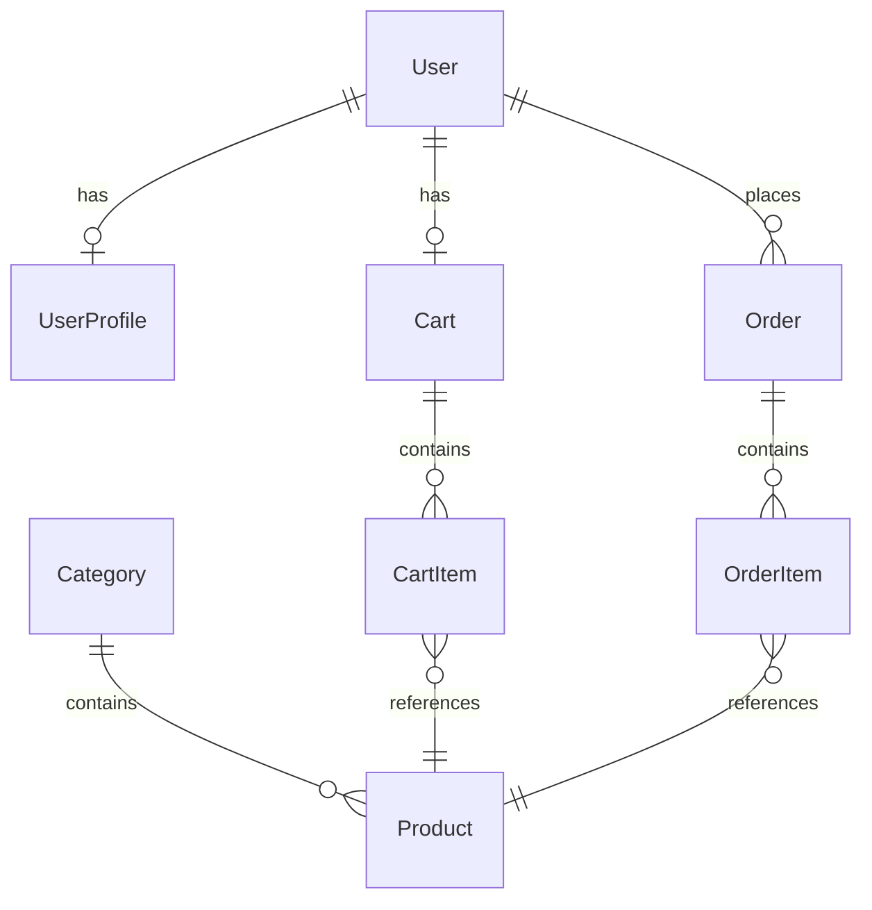

A modern and responsive E-commerce Store web application designed to provide users with a smooth online shopping experience. The project includes product browsing, shopping cart functionality, and a user-friendly interface for managing online purchases.


# 🛒 CodeAlpha E-commerce Store

<div align="center">


**A modern, full-stack e-commerce web application built with Django and Bootstrap 5**

*Developed for the CodeAlpha Full Stack Development Internship*

</div>

---

## ✨ Features

### 🔐 Authentication & Security
- User registration with form validation
- Secure login/logout functionality
- Password validation with Django's built-in validators
- CSRF protection on all forms
- Protected routes for checkout and user dashboard

### 🏠 Home Page
- Modern gradient hero section with call-to-action
- Featured products showcase
- Category browsing
- Why Choose Us feature cards

### 🛍️ Product Management
- Product listing with responsive grid
- Detailed product pages with related products
- Search functionality
- Category filtering
- Price sorting (low to high, high to low)
- Pagination

### 🛒 Shopping Cart
- Add/remove products
- Update quantities
- Cart total calculation
- Persistent cart (session-based for guests, database for users)

### 💳 Checkout
- Shipping information form
- Order summary review
- Secure order placement
- Order confirmation with details

### 👤 User Dashboard
- View and edit profile
- Order history with status tracking
- Recent orders on profile page

### ⚙️ Admin Panel
- Full CRUD for products, categories, orders
- Order status management
- User management
- Inline order items

---

## 🛠️ Tech Stack

| Technology | Purpose |
|------------|----------|
| **Django 4.2** | Backend framework |
| **Python 3.9+** | Programming language |
| **SQLite** | Database |
| **Bootstrap 5.3** | Frontend framework |
| **HTML5/CSS3** | Markup & styling |
| **JavaScript (ES6)** | Client-side interactivity |
| **Bootstrap Icons** | Icon library |
| **Google Fonts** | Typography (Inter) |

---

## 🚀 Quick Start

### Prerequisites
- Python 3.9 or higher
- pip (Python package manager)

### Installation

1. **Clone the repository**
```bash
git clone <repository-url>
cd CodeAlpha_EcommerceStore
```

2. **Create a virtual environment**
```bash
python -m venv venv
source venv/bin/activate   # Linux/Mac
venv\Scripts\activate      # Windows
```

3. **Install dependencies**
```bash
pip install -r requirements.txt
```

4. **Run database migrations**
```bash
python manage.py makemigrations accounts store
python manage.py migrate
```

5. **Load sample data**
```bash
python seed_data.py
```

6. **Start the development server**
```bash
python manage.py runserver
```

7. **Open your browser**
```
http://127.0.0.1:8000
```

### Admin Access
- URL: `http://127.0.0.1:8000/admin/`
- Username: `admin`
- Password: `admin123`

---

## 📁 Project Structure

```
CodeAlpha_EcommerceStore/
├── ecommerce/              # Project configuration
│   ├── settings.py
│   ├── urls.py
│   └── ...
├── accounts/               # User authentication & profiles
│   ├── models.py           # UserProfile model
│   ├── views.py            # Auth & profile views
│   ├── forms.py            # Registration & profile forms
│   └── ...
├── store/                  # Core e-commerce functionality
│   ├── models.py           # Product, Cart, Order models
│   ├── views.py            # Store, cart, checkout views
│   ├── forms.py            # Checkout form
│   ├── admin.py            # Admin customization
│   ├── context_processors.py
│   └── templatetags/
├── templates/              # HTML templates
│   ├── base.html           # Base template
│   ├── accounts/           # Auth templates
│   └── store/              # Store templates
├── static/                 # Static assets
│   ├── css/style.css       # Custom styles
│   └── js/main.js          # Client-side JS
├── media/                  # Uploaded files
├── manage.py
├── requirements.txt
├── seed_data.py
└── README.md
```

---

## 📊 Database Models



---

## 🎨 Design Highlights

- **Premium UI** with clean white theme and blue accents
- **Responsive design** for desktop, tablet, and mobile
- **Smooth animations** and hover effects
- **Professional cards** with shadow and border-radius
- **Gradient hero section** with decorative elements
- **Color-coded order statuses** for easy tracking

---

## 👨💻 Developer

Developed as part of the **CodeAlpha Full Stack Development Internship**.

---

## 📄 License

This project is licensed under the MIT License.
